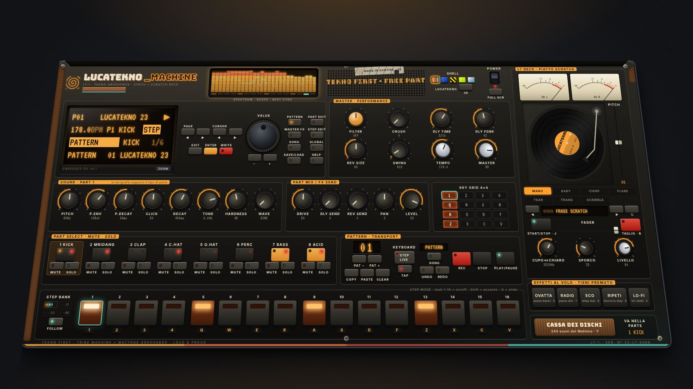

# LucaTekno_Machine · LT-1

Groovebox tekno per PC nata dall'unione di due console:

- **TRIBE MACHINE TM-1** ([release tribe-machine-v0.2.0](https://github.com/Akaoni97/RandomEgg-s/releases/tag/tribe-machine-v0.2.0)):
  il cuore. Motore a sintesi in tempo reale (kick, snare, clap, hat, perc FM, basso, acid 303), sequencer a 16-64 step,
  motion sequence, song mode, LCD a menu, export WAV, MIDI, app Windows.
- **MATTONE GROOVEBOX** (la console nell'artifact): la cassa di **240 suoni** (199 campioni veri + 41 sintetizzati),
  il **piatto scratch** con le tecniche automatiche, gli **effetti al volo** da tenere premuti, i **VU meter** ad ago
  e i colori della cantina.

**Priorità alla tekno**: il pannello, il motore, i BPM (160-200), i preset e la scocca di casa sono tekno.
Tutto ciò che arriva dal Mattone è al servizio del set: i campioni diventano parti del sequencer tekno
(con step, accenti, motion e manopole), il piatto scratcha a tempo col sequencer, gli effetti agiscono sul mix intero.



Progetto indipendente: nessun logo o marchio Korg, nessun brano di terzi. Licenze dei campioni in fondo.

---

## Cosa arriva dal Mattone

### LT DECK · piatto scratch (ala destra del pannello)

- **Trascina il disco** lungo il solco (o su e giù vicino al perno): il disco gira esattamente sotto il dito,
  la velocità della mano è la velocità del suono, tenerlo fermo fa silenzio. Lasciandolo mentre si muove, prosegue
  con lo slancio. Rotellina del mouse = scratch fine.
- **BABY · CHIRP · FLARE · TEAR · TRANS · SCRIBBLE**: le tecniche classiche, eseguite dal piatto **a tempo col
  sequencer** (ripartono dall'inizio della battuta). Toccare il disco riprende il controllo.
- **Disco** (◀ ▶, tasto **U**): frase da scratch del Mattone ("aaah" · orchestra hit · "yeah" · "hey" · "uuoh"),
  le singole voci, coro, accordo, cassa 808, **LOOP DEL PATTERN** (registra offline una battuta della macchina e la
  mette sul disco) e **PARTE SELEZIONATA** (una battuta della sola parte). ↻ ri-registra il loop dopo una modifica.
  Dalla cassa dei dischi, **→ PIATTO** mette qualunque suono sul disco.
- **START/STOP** (tasto **J**) fa girare il disco a 33⅓, **PITCH** ±16 %, **FADER** del piatto,
  **TAGLIO** (tieni premuto, tasto **B**) apre e chiude il fader al volo.
- **CUPO↔CHIARO** e **SPORCO** cambiano il colore dello scratch (fino a un campionatore a 12 bit), **LIVELLO** il volume.
- Il piatto entra nel mix **prima** degli effetti master: filtro, crush ed effetti al volo agiscono anche sullo scratch.
- DSP del Mattone nell'AudioWorklet (thread audio), con interpolazione di Hermite e risposta della testina
  proporzionale alla velocità; se il worklet non è disponibile passa a uno ScriptProcessor.

### Effetti al volo · tieni premuto (tasti 6 7 8 9 0)

| Pad | Effetto |
|---|---|
| **OVATTA** | passa-basso risonante a 520 Hz su tutto il mix |
| **RADIO** | passa-alto a 1,6 kHz: la cassa sparisce, resta la "radiolina" |
| **ECO** | dub throw: tutto il mix nel delay a 3/16 con ripetizioni lunghe; al rilascio le code restano |
| **RIPETI** | blocca lo step che si sta ascoltando e lo ripete; al rilascio si riparte esattamente a tempo |
| **LO-FI** | bitcrusher spinto + passa-basso a 3,8 kHz |

Non modificano il pattern (niente undo, niente autosave): si suonano come sul Mattone.

### Cassa dei dischi (tasto **Y**, o PART EDIT → SOUND/OSC → CRATE)

240 suoni in 12 categorie, ordinate per priorità tekno (percussioni, batteria, effetti, voci, bassi, synth…):
conghe, bongo, darbuka, cajón, mridangam, taiko, piatti veri, voci formantiche, riser, zap, laser, piani,
organi, archi, fiati, chitarre, bassi. Ricerca per nome, ▶ per ascoltare.

- **→ Pn** mette il suono nella parte selezionata: la parte diventa **SAMPLE** e mantiene step e mute/solo; si
  suona con PITCH (anche per step), START, REVERSE, CUTOFF, RESO, DECAY, DRIVE, mandate e motion, come le altre.
  Gli strumenti intonati vengono portati automaticamente sulla tonica **F** delle parti BASS/ACID.
- **→ PIATTO** mette il suono sul disco.
- I campioni sono **dentro l'app** (un piccolo modulo per file, caricato solo quando serve): funziona offline,
  anche nell'eseguibile Windows, e i progetti esportati restano leggeri.

### VU meter, scocca LUCATEKNO, preset

- Due **VU ad ago** (L/R) dell'uscita master, sopra il piatto.
- Scocca **LUCATEKNO** (predefinita): i colori della cantina del Mattone sul pannello tekno. Le quattro scocche della
  TRIBE MACHINE restano disponibili (selettore SHELL, F4).
- Due preset nuovi in testa alla lista: **LUCATEKNO 23** e **CONGA ACID** (vedi sotto).

---

## App desktop per Windows 11 (consigliata)

Due versioni, stesso programma:

- **`LucaTekno_Machine-Setup-<versione>.exe`** — installer: scegli la cartella, crea l'icona sul desktop e nel menu Start,
  si disinstalla da *Impostazioni → App*. Non servono diritti di amministratore.
- **`LucaTekno_Machine-Portable-<versione>.exe`** — un solo file, nessuna installazione: doppio clic e parte (anche da chiavetta USB).

Dove trovarli: su GitHub, sezione **Releases** del repository → la più recente **LucaTekno_Machine … per Windows** →
clic sul file `.exe` (download diretto, niente zip). La Release viene aggiornata automaticamente a ogni build
riuscita: il workflow **"LucaTekno_Machine · Windows"** compila su Windows, prova l'app impacchettata e solo se
la prova passa pubblica i file. In alternativa, ogni esecuzione del workflow ha anche l'artifact
**LucaTekno_Machine-windows** (zip con i due eseguibili e lo screenshot della prova).

Al primo avvio Windows SmartScreen può mostrare *"PC protetto da Windows"*, perché l'eseguibile non è firmato
con un certificato commerciale: clicca **Ulteriori informazioni → Esegui comunque**.

Cosa cambia rispetto alla versione browser:
- finestra dedicata a pieno schermo (massimizzata all'avvio, F11 = schermo intero), nessuna barra del browser;
- l'audio parte senza restrizioni di autoplay e il sequencer non rallenta quando la finestra è in secondo piano;
- **Salva con nome** nativo per WAV e progetti, con cartella predefinita `Documenti\LucaTekno_Machine`;
- progetti, slot, campioni e mappa tasti salvati nella cartella utente dell'app (`%APPDATA%\LucaTekno_Machine`);
- permessi ridotti al minimo: solo MIDI e schermo intero (niente microfono, webcam, posizione), nessuna navigazione esterna;
- completamente offline; una sola istanza alla volta; se l'interfaccia va in crash si ricarica (il progetto è salvato in automatico).

### Compilare l'app da sé

Su Windows (PowerShell, nella cartella `lucatekno-machine`):

```powershell
npm install
npm run dist:win     # crea release\LucaTekno_Machine-Setup-*.exe e release\LucaTekno_Machine-Portable-*.exe
npm run app          # prova l'app desktop senza impacchettarla
npm run test:app     # prova automatica di avvio (finestra, audio, LED, render)
```

Da Linux la stessa build funziona con Wine installato (anche a 32 bit, per lo stub dell'installer NSIS).

Scelta tecnica: **Electron** invece di Tauri. Electron include lo stesso Chromium su cui il motore audio è stato
misurato (AudioWorklet, timing, Web MIDI identici), mentre Tauri userebbe WebView2 con comportamenti diversi su
download, MIDI e autoplay da riverificare. Il prezzo è la dimensione: circa 110 MB invece di pochi MB.
La latenza resta quella dell'audio di Chromium su Windows (WASAPI condiviso, tipicamente 10-40 ms); ASIO non è supportato.

## Versione browser (senza installare nulla)

**Subito, senza Node**: `npm run build:artifact` crea `dist-artifact/lucatekno-machine.html`, un unico file
(10 MB, campioni e font inclusi) che si apre con un doppio clic in Chrome/Edge. Aperto da file il bitcrusher è
disattivato e il piatto usa il motore di riserva: per il suono completo usa l'app desktop o `npm start`.


1. Installa **Node.js LTS** (20.19 o successivo) da <https://nodejs.org>.
2. Fai doppio clic su **`AVVIA-LUCATEKNO-MACHINE.bat`**: la prima volta scarica le dipendenze, poi si apre il browser su
   `http://localhost:4173`.
3. Clicca sul pannello o premi un tasto per **accendere** la macchina, poi **Spazio**.

```powershell
npm install      # una sola volta
npm start        # build + avvio locale, apre il browser
npm run dev      # modalità sviluppo con ricarica automatica
npm test         # test automatici
```

Browser consigliati: Chrome o Edge. Dopo l'installazione funziona offline.

---

## Console 3D e scocche intercambiabili

La macchina è una console in 3D appoggiata sul tavolo: pannello inclinato, spessore della scocca, fianchi,
ombra, e una leggera parallasse che segue il mouse. **F3** (o il pulsante 3D/FLAT) passa alla vista frontale,
più leggibile su schermi piccoli. Tutti i comandi funzionano in entrambe le viste.

Cinque **scocche** (selettore SHELL in alto a destra, tasto **F4**, oppure GLOBAL → SHELL). Il cambio è animato:
la console si solleva, gira e torna giù con la scocca nuova. Ogni scocca cambia chassis, materiali, LCD (colori
e font), luci dei tasti step, LED, manopole, pulsanti, serigrafie, adesivi e stile del visualizzatore:

| Scocca | Chassis | Display | Luci | Visualizzatore |
|---|---|---|---|---|
| **LUCATEKNO** (predefinita) | nero affumicato della cantina del Mattone, fianchi in legno, strisce ambra-arancio-mattone-verde acqua | OLED ambra su nero, font VT323 | arancio, playhead verde acqua | barre a segmenti |
| **TRIBE BLUE** | metallo blu spazzolato (stile Electribe) | LCD ambra, font VT323 | rosso / arancio, playhead verde | barre a segmenti |
| **UNDERGROUND** | nero verniciato a polvere, cemento graffiato, fianchi e fascia di pericolo gialli e neri | display rosso su nero tipo VFD, font Syne Mono | rosso fuoco, playhead bianco | blocchi LED |
| **ACID** | giallo acido con retino, scacchi neri, manopole verdi trasparenti | LCD verde STN, font DotGothic16 | verde neon, accenti gialli, playhead rosa UV | oscilloscopio protagonista |
| **MILLENNIUM CHROME** | alluminio cromato spazzolato, fianchi in acrilico fumé | LCD blu negativo, font Share Tech Mono | azzurro ghiaccio, playhead turchese | spettro a specchio |

La scelta della scocca e della vista è salvata sul PC. Tutti i font sono inclusi: funziona offline.

**Visualizzatore audio** (al posto delle valvole): spettro in 28 bande e oscilloscopio letti in tempo reale
dall'uscita master, con impulsi sincronizzati al sequencer (flash su ogni quarto, rimbalzo su ogni kick) e una
riga di 16 segmenti che segue la posizione nella battuta. A macchina ferma "respira" lentamente.

## Tastiera (codici fisici: la griglia resta uguale con QWERTY, AZERTY, QWERTZ)

I 16 step corrispondono a una griglia 4×4 sulla tastiera (visibile anche sul pannello, sezione KEY GRID):

```
 1   2   3   4      → step 1-4    (LIVE: parti 1-4)
 Q   W   E   R      → step 5-8    (LIVE: parti 5-8)
 A   S   D   F      → step 9-12   (LIVE: note 1-4 della parte selezionata)
 Z   X   C   V      → step 13-16  (LIVE: note 5-8)
```

| Tasto | Funzione |
|---|---|
| Spazio | Play / Pausa |
| Esc | Stop (premuto a macchina ferma = silenzia anche le code) |
| Shift + Spazio | Registrazione ON/OFF (quantizzata, in LIVE MODE) |
| Tab | Modalità tastiera **STEP ↔ LIVE** |
| 1-4 Q-R A-F Z-V | Step on/off (STEP) · pad suonabili (LIVE) |
| Shift + step | Accento (LIVE: colpo accentato) |
| Tieni premuto uno step + `+`/`−` | Nota dello step (Shift = ottava) — lo step non si spegne |
| G | Slide sullo step tenuto (o sullo step selezionato) |
| ↑ / ↓ | Parte precedente / successiva |
| ← / → | Voce precedente / successiva del display |
| `+` / `−` (anche tastierino) | Modifica il valore selezionato (Shift = fine) |
| , / . | Pagina LCD precedente / successiva |
| Enter | ENTER (esegue la voce: salva, carica, export…) |
| Backspace | EXIT (torna alla pagina PATTERN) |
| M / N | Mute / Solo della parte selezionata |
| O / P | Banco step precedente / successivo (pattern da 32-64 step) |
| Pag↑ / Pag↓ | Pattern successivo / precedente (in riproduzione: cambio a fine battuta) |
| L | Song mode ON/OFF |
| T | Tap tempo |
| Canc | Cancella la parte (Shift+Canc = tutto il pattern) |
| Ctrl+S | Salva (WRITE nello slot selezionato) |
| Ctrl+C / Ctrl+V | Copia / incolla pattern |
| Ctrl+Z / Ctrl+Y | Annulla / ripeti (fino a 100 passi) |
| H o F1 | Aiuto con tutti i comandi |
| F2 | Zoom del display |
| F11 | Schermo intero |
| F3 | Vista 3D / frontale |
| F4 | Scocca successiva (Shift+F4 = precedente) |
| 6 7 8 9 0 (tieni premuto) | Effetti al volo: OVATTA, RADIO, ECO, RIPETI, LO-FI |
| B (tieni premuto) | TAGLIO del fader del piatto |
| J | Piatto START / STOP |
| U | Disco successivo (Shift+U = precedente) |
| Y | Cassa dei dischi |

`+` e `−` sono riconosciuti anche dal carattere: sulla tastiera italiana funzionano i tasti `+` e `-` normali.
Tutti i comandi a tasto singolo si **riassegnano** da GLOBAL → KEY MAP (o dall'aiuto): un tasto riassegnato
viene tolto dal comando precedente, quindi non si creano conflitti. La mappa è salvata sul PC.
I tasti premuti si illuminano sul pannello; se la finestra perde il fuoco tutte le note e i tasti tenuti
vengono rilasciati (niente note bloccate).

**Mouse**: manopole con trascinamento verticale (Shift = fine), rotellina, doppio clic = valore numerico,
tasto destro = valore iniziale. Step: clic = on/off, tasto destro o Shift+clic = accento, Alt+clic = slide.
Rotellina sul display = VALUE. Mouse e tastiera si usano insieme.

---

## Il pannello tekno (dalla TRIBE MACHINE)

- **LCD**: riga 1 pattern/nome/trasporto/REC · riga 2 BPM, parte, modalità tastiera, mute/solo ·
  righe 3-4 pagina, voce, barra e valore. I messaggi (salvataggi, valori delle manopole) compaiono in negativo.
- Pagine: PATTERN · SOUND/OSC · FILTER · ENVELOPE · MODULATION · PART FX/MIX · MASTER FX · STEP EDIT ·
  SONG · GLOBAL · SAVE/LOAD. Pulsanti MODE dedicati, PAGE ◀▶, CURSOR ◀▶, ENTER, EXIT, WRITE (LED rosso = modifiche non salvate).
- **SOUND**: 8 manopole, le serigrafie cambiano col tipo di parte (kick, snare, clap, hat, perc, bass, acid).
- **PART MIX**: drive, mandate delay/riverbero, pan, livello.
- **MASTER**: filtro performativo LP↔HP, bitcrusher, delay sincronizzato, riverbero, swing, tempo, volume.
- **PARTI**: selezione (LED rosso = trigger), MUTE, SOLO. **TRANSPORT**: display pattern, PAT ±, COPY/PASTE/CLEAR,
  STEP/LIVE, TAP, REC, STOP, PLAY.
- **16 STEP**: rosso = attivo, arancio = accento, verde = playhead, ⌒ = slide, numero = nota (parti melodiche).
- Visualizzatore audio: spettro e oscilloscopio dell'uscita master, a tempo con il sequencer.

---

## Motore audio

Tutto è sintetizzato in tempo reale con Web Audio API:

| Parte | Sintesi |
|---|---|
| KICK | sinusoide/triangolo con pitch envelope esponenziale, click di rumore, clip asimmetrico "hardness", tono |
| SNARE | due oscillatori con pitch envelope + rumore filtrato (snappy) |
| CLAP | rumore passa-banda con tre colpi ravvicinati e coda |
| C.HAT / O.HAT | 6 onde quadre a rapporti inarmonici + rumore, passa-alto risonante. Il closed hat strozza l'open |
| PERC | FM a due operatori con pitch envelope: tom tribali, legni, metalli industriali; altezza per step |
| BASS | synth monofonico: sine/tri/saw/square + sub, LPF/HPF risonante con inviluppo, glide, LFO sincronizzato |
| ACID | monofonico stile 303: saw/square, filtro 24 dB/ott risonante, accent, slide vero (legato senza retrigger), LFO |

Per parte: drive (waveshaper con oversampling e compensazione), pan, livello, mandate.
Master: filtro LP/HP, bitcrusher (AudioWorklet), delay sincronizzato con feedback filtrato, riverbero a
convoluzione con IR generata, **limiter + soft clipper di sicurezza** (picco massimo 0,98).

## Motion sequence

Premi **REC** (Shift+Spazio) mentre la macchina suona e muovi una manopola della parte (SOUND o PART MIX):
il valore viene scritto su ogni step che passa. Da quel momento la manopola **si muove da sola** seguendo
la registrazione (arco verde e badge **M**). Sugli step non registrati vale la posizione della manopola.
Funziona anche con la rotella VALUE sulle pagine della parte e con i CC MIDI.
Cancellazione: PART EDIT → pagina PART FX/MIX → MOTION → ENTER due volte (oppure Ctrl+Z subito dopo).

## Song mode

Pagina **SONG** (pulsante MODE SONG): catena fino a 64 voci, ognuna con pattern e numero di ripetizioni.
POSITION sceglie la voce, PATTERN e REPEATS la modificano, INSERT duplica, DELETE elimina, LENGTH mostra la durata.
Con **SONG** acceso (pulsante SONG sul pannello o tasto L) PLAY suona la catena: ogni pattern viene suonato
per intero il numero di volte indicato, poi si passa al successivo; alla fine riparte dall'inizio. STOP torna
all'inizio. Il display mostra `S03` (voce) e il pannello `S03/05`. In SONG MODE l'EXPORT WAV renderizza l'intera song.
Ogni preset contiene una song dimostrativa (A ×4 → B ×2 → A ×4).

## Campioni personali (WAV, MP3, OGG, FLAC, AIFF)

- **Trascina un file audio sul pannello**: va nella parte selezionata, che diventa di tipo SAMPLE.
- Oppure PART EDIT → SOUND/OSC → voce SAMPLE → ENTER.
- Parametri: PITCH (±24 semitoni, e nota per step), START, REVERSE, CUTOFF, RESO, DECAY, più i comuni.
- Limiti: 12 MB e 30 secondi per file. I campioni sono salvati sul PC (IndexedDB del browser) e
  **incorporati nel file .ltm.json esportato**, quindi un progetto esportato è completo e portabile.
- Trascinare un file `.ltm.json` sul pannello lo importa.

## MIDI (Web MIDI, Chrome/Edge)

GLOBAL → MIDI IN → ENTER (il browser chiede il permesso; poi si riattiva da solo a ogni accensione).

| Messaggio | Funzione |
|---|---|
| Canale 10, note GM | 36 kick · 38/40 snare · 39 clap · 42/44 hat · 46 open hat · tom 41-50 perc |
| Altri canali | Suonano la parte selezionata (F3 = nota base), con legato per BASS/ACID |
| Velocity ≥ 100 | Accento |
| CC 70-77 | Le 8 manopole SOUND della parte selezionata |
| CC 7 / 10 / 91 / 93 / 94 | Level / Pan / Rev send / Dly send / Drive |
| CC 1 (mod wheel) | Filtro master (passa-basso) |

Con REC attivo, le note MIDI vengono registrate come i pad e i CC come motion.

## Preset (7, ognuno con pattern A + variazione B)

**LUCATEKNO 23 (178)** · **CONGA ACID (174)** · OLD SCHOOL TRIBE (172) · FREETEKNO HYPNOTIC (176) · MENTAL ACID (186) · INDUSTRIAL TEKNO (168) · HARDTEK PUMPING (192).
Si caricano da SAVE/LOAD → PRESET → LOAD PRESET (ENTER due volte per confermare).
Al primo avvio viene caricato LUCATEKNO 23 (mridangam vero sopra cassa dritta, acid ipnotico; la variazione B usa la voce "yeah" del Mattone come stab); in seguito si riapre automaticamente l'ultimo progetto.

## Salvataggi

- **Autosave** continuo nel browser: chiudendo e riaprendo si ritrova tutto.
- **8 slot** locali (SAVE/LOAD → SLOT, WRITE / LOAD; Ctrl+S salva nello slot selezionato).
- **EXPORT/IMPORT FILE**: progetto completo in `.ltm.json` (16 pattern, suoni, step, motion, song, campioni), da copiare dove vuoi.
  Si importano anche i progetti `.tribe.json` della TRIBE MACHINE. I suoni della cassa non vengono copiati nel file: sono già dentro la macchina.
- **EXPORT WAV**: render offline del pattern corrente (4-64 battute) o, in SONG MODE, dell'intera song (fino a 15 minuti) in WAV 16 bit.
- **Nomi**: progetto (SAVE/LOAD → PROJECT), pattern (PATTERN → NAME), parte (PART FX/MIX → PART NAME), con ENTER.
- **Undo/redo** di ogni modifica ai contenuti (Ctrl+Z / Ctrl+Y o pulsanti UNDO/REDO).

I file importati vengono validati e riparati: un file corrotto non blocca la macchina.

---

## Architettura

```
src/
  audio/        motore audio (indipendente da UI e timer)
    engine.ts     bus per parte, mixer, FX master, effetti al volo, ingresso del piatto, VU L/R, limiter
    deck.ts       LT DECK: nucleo DSP del piatto (AudioWorklet), colore, frase da scratch   ← Mattone
    crate.ts      cassa dei dischi: catalogo, caricamento dei campioni inclusi, intonazione ← Mattone
    mattone.ts    i 41 suoni sintetizzati del Mattone (voci formantiche, riser, zap…)    ← Mattone
    drums.ts      voci percussive one-shot con choke senza click
    monosynth.ts  bass/acid persistenti (slide e legato reali)
    dsp.ts        curve di saturazione, rumore, IR riverbero, worklet bitcrusher
    samples.ts    campioni: IndexedDB, decodifica, incorporazione nei file
    offline.ts    render offline a blocchi (pattern e song) + encoder WAV
  sequencer/    clock e scheduling
    sequencer.ts  lookahead scheduler sull'orologio audio, registrazione quantizzata
    timing.ts     funzioni pure (swing, quantizzazione, tap tempo)
  state/        modello dati, store, preset, salvataggi, motion, undo/redo
  input/        tastiera (mappa riassegnabile, logica step/pad condivisa col mouse) e MIDI
  lcd/          sistema di menu del display
  ui/           pannello React (manopole, pulsanti, LCD, step, overlay, ala LT DECK, cassa)
  machine.ts    "firmware": collega stato, motore, sequencer e animazione LED
  deckControl.ts comandi del piatto, degli effetti al volo e della cassa
crate/          i 199 campioni mp3 del Mattone
```

**Temporizzazione**: un timer in un Web Worker sveglia il sequencer ogni 20 ms; il sequencer programma
nel motore tutti gli step dei successivi 120 ms con tempi assoluti dell'`AudioContext`. Il jitter dei timer
JavaScript non arriva mai all'audio. Il BPM viene letto a ogni step, quindi cambiarlo durante la riproduzione è
immediato e senza salti. Se il PC si blocca, gli step persi vengono saltati invece di suonare tutti insieme.

**LED**: lo step si illumina quando `currentTime − latenza d'uscita` raggiunge il tempo dello step, cioè quando lo
senti. La stessa compensazione è usata per quantizzare la registrazione live; lo step appena suonato a mano non
viene risuonato dal sequencer (niente doppi colpi).

**Motion e song**: il sequencer calcola per ogni step i parametri effettivi (manopole + valori registrati) e li
programma nel motore allo stesso istante audio della nota; il song mode decide il pattern successivo a fine pattern
nello stesso punto in cui avviene il cambio pattern in coda, quindi le transizioni sono a tempo.

**Parametri senza click**: tutte le manopole usano rampe brevi; il cutoff dei synth sta su `frequency` mentre
inviluppo e LFO agiscono su `detune`, così muovere il CUTOFF non interferisce con le automazioni programmate.

La separazione motore/sequencer/stato/UI/input permette di aggiungere un ingresso MIDI (Web MIDI → stesse
funzioni `livePlay`/`dispatch`) e una UI diversa (mobile) senza toccare il motore.

### Analisi rapida (fattibilità e rischi)

- **Fattibilità**: Web Audio offre oscillatori, filtri biquad, waveshaper, convolver e AudioWorklet nativi, sufficienti
  per una groovebox a sintesi con 8 parti. Il render offline è 6-7 volte più veloce del tempo reale.
- **Rischi principali** e come sono gestiti:
  timing (scheduler anticipato, verificato a ±1 campione), latenza su Windows (`latencyHint: interactive`, compensazione
  nei LED; per l'audio a latenza minima servirà il pacchetto desktop/ASIO in fase 3), click e picchi (rampe, choke da 4 ms,
  limiter + clipper), note bloccate (gestione legato nel sequencer, rilascio su stop/blur/mute), politiche di autoplay
  (pulsante POWER), conflitti con scorciatoie del browser (solo Ctrl+S/C/V intercettati, `Alt` lasciato al sistema).
- Tone.js non è usato: la sintesi è scritta direttamente su Web Audio per avere controllo totale su inviluppi,
  slide e scheduling, con meno dipendenze.

---

## Verifiche effettuate

- `npm test`: 26 test. Quelli della TRIBE MACHINE (timing, swing, quantizzazione, tap tempo, salvataggio→riapertura
  di tutti i preset, riparazione di file corrotti, motion, song, undo/redo, rinomina, range, tasti unici) più quelli
  nuovi: catalogo della cassa (240 suoni, ogni file o generatore presente, nomi e intonazione), nucleo DSP del piatto
  (silenzio da fermo, motore, mano, taglio, tutte le tecniche automatiche), preset con campioni, import dei progetti
  TRIBE MACHINE, nessun conflitto tra i tasti nuovi e quelli vecchi.
- Prova nel browser (Chromium, mouse e tastiera simulati): accensione, piatto in moto (RMS 0,34), scratch trascinando
  il disco (0,24), BABY a tempo con il pattern in play, OVATTA / ECO / LO-FI / TAGLIO, RIPETI che blocca lo step e lo
  rilascia, LOOP DEL PATTERN sul disco, cassa: ricerca, conga nella parte 2 (diventa SAMPLE), conga sul piatto.
  Nessun errore in console.
- Render offline di tutti i pattern A e B dei 7 preset: nessun NaN, picco tra 0,86 e 0,97.
- App desktop Electron (Linux, display virtuale): titolo, accensione, riproduzione e LED, piatto che suona,
  campioni della cassa caricati da `file://`, render offline, nessun errore. Lo stesso controllo gira su Windows nel
  workflow **"LucaTekno_Machine · Windows"**, che pubblica installer e portatile nella Release `lucatekno-machine-v<versione>`.

Non verificato da qui: ascolto reale su un PC Windows con la sua scheda audio e controller MIDI fisici.
L'export WAV contiene il sequencer e gli effetti del pattern, non lo scratch né gli effetti al volo (sono gesti dal vivo).

---

## Licenze dei suoni della cassa

I campioni arrivano dal Mattone Groovebox:
[VCSL](https://github.com/sgossner/VCSL) (Versilian Studios, CC0) ·
FluidR3 GM (Frank Wen, CC BY 3.0) via [midi-js-soundfonts](https://github.com/gleitz/midi-js-soundfonts) ·
[Salamander Grand Piano](https://archive.org/details/SalamanderGrandPianoV3) (Alexander Holm, CC BY 3.0) ·
campioni di mridangam di Arthur Carabott, suonati da Harishankar V Menon (CC BY-SA 4.0).
I suoni "sintetizzati dal vivo" e tutti i suoni del motore tekno sono generati dal codice.
I crediti sono anche in fondo alla finestra della cassa dei dischi.
