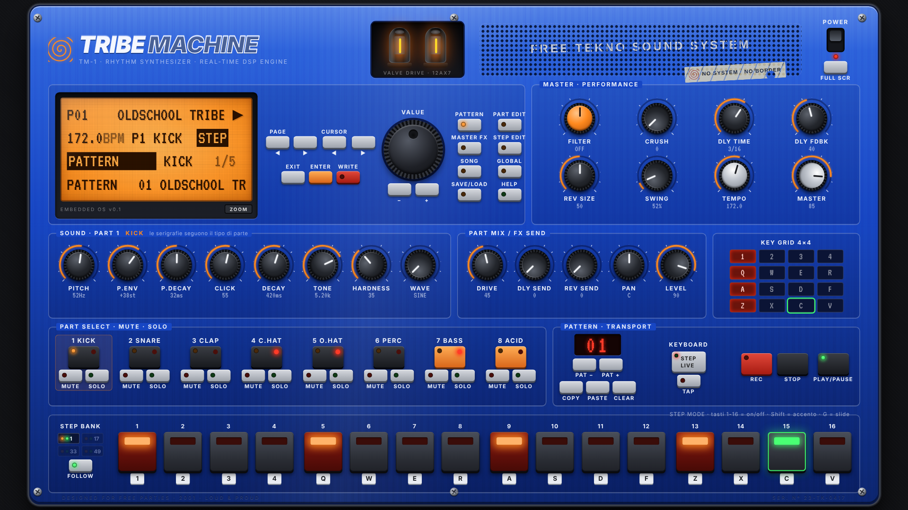

# TRIBE MACHINE · TM-1

Groovebox virtuale per PC ispirata alle Electribe EMX-1/ESX-1 e alla scena Free Tekno / Tribe.
Pannello hardware blu, display LCD arancione con menu veri, 16 step retroilluminati,
motore audio a **sintesi in tempo reale** (nessun campione) e controllo completo da tastiera.



Progetto indipendente: nessun logo o marchio Korg, nessun campione o brano di terzi.
Tutti i suoni sono generati dal codice, tutti i pattern sono originali.

---

## Avvio su Windows 11

1. Installa **Node.js LTS** (20.19 o successivo) da <https://nodejs.org> (Avanti → Avanti → Fine).
2. Fai doppio clic su **`AVVIA-TRIBE-MACHINE.bat`**.
   La prima volta scarica le dipendenze (serve internet solo per questo), poi si apre il browser su
   `http://localhost:4173`.
3. Clicca sul pannello o premi un tasto qualsiasi per **accendere** la macchina (il browser avvia
   l'audio solo dopo un gesto dell'utente). Premi **Spazio**.

Dal terminale (PowerShell, nella cartella `tribe-machine`):

```powershell
npm install      # una sola volta
npm start        # build + avvio locale, apre il browser
npm run dev      # modalità sviluppo con ricarica automatica
npm test         # test automatici
```

Browser consigliati: **Chrome** o **Edge** (migliore latenza audio e nomi dei tasti secondo il layout reale).
Dopo l'installazione funziona **completamente offline**: niente server remoti, account o cloud.
**F11** (o il tasto FULL SCR) = schermo intero; il pannello si ridimensiona in proporzione alla finestra.

---

## Tastiera (codici fisici: la griglia resta uguale con QWERTY, AZERTY, QWERTZ)

I 16 step corrispondono a una griglia 4×4 sulla tastiera (visibile anche sul pannello, sezione KEY GRID):

```
 1   2   3   4      → step 1-4    (LIVE: parti 1-4)
 Q   W   E   R      → step 5-8    (LIVE: parti 5-8)
 A   S   D   F      → step 9-12   (LIVE: note 1-4 della parte selezionata)
 Z   X   C   V      → step 13-16  (LIVE: note 5-8)
```

| Tasto | Funzione |
|---|---|
| Spazio | Play / Pausa |
| Esc | Stop (premuto a macchina ferma = silenzia anche le code) |
| Shift + Spazio | Registrazione ON/OFF (quantizzata, in LIVE MODE) |
| Tab | Modalità tastiera **STEP ↔ LIVE** |
| 1-4 Q-R A-F Z-V | Step on/off (STEP) · pad suonabili (LIVE) |
| Shift + step | Accento (LIVE: colpo accentato) |
| Tieni premuto uno step + `+`/`−` | Nota dello step (Shift = ottava) — lo step non si spegne |
| G | Slide sullo step tenuto (o sullo step selezionato) |
| ↑ / ↓ | Parte precedente / successiva |
| ← / → | Voce precedente / successiva del display |
| `+` / `−` (anche tastierino) | Modifica il valore selezionato (Shift = fine) |
| , / . | Pagina LCD precedente / successiva |
| Enter | ENTER (esegue la voce: salva, carica, export…) |
| Backspace | EXIT (torna alla pagina PATTERN) |
| M / N | Mute / Solo della parte selezionata |
| O / P | Banco step precedente / successivo (pattern da 32-64 step) |
| Pag↑ / Pag↓ | Pattern successivo / precedente (in riproduzione: cambio a fine battuta) |
| T | Tap tempo |
| Canc | Cancella la parte (Shift+Canc = tutto il pattern) |
| Ctrl+S | Salva (WRITE nello slot selezionato) |
| Ctrl+C / Ctrl+V | Copia / incolla pattern |
| H o F1 | Aiuto con tutti i comandi |
| F2 | Zoom del display |
| F11 | Schermo intero |

`+` e `−` sono riconosciuti anche dal carattere: sulla tastiera italiana funzionano i tasti `+` e `-` normali.
Tutti i comandi a tasto singolo si **riassegnano** da GLOBAL → KEY MAP (o dall'aiuto): un tasto riassegnato
viene tolto dal comando precedente, quindi non si creano conflitti. La mappa è salvata sul PC.
I tasti premuti si illuminano sul pannello; se la finestra perde il fuoco tutte le note e i tasti tenuti
vengono rilasciati (niente note bloccate).

**Mouse**: manopole con trascinamento verticale (Shift = fine), rotellina, doppio clic = valore numerico,
tasto destro = valore iniziale. Step: clic = on/off, tasto destro o Shift+clic = accento, Alt+clic = slide.
Rotellina sul display = VALUE. Mouse e tastiera si usano insieme.

---

## Il pannello

- **LCD**: riga 1 pattern/nome/trasporto/REC · riga 2 BPM, parte, modalità tastiera, mute/solo ·
  righe 3-4 pagina, voce, barra e valore. I messaggi (salvataggi, valori delle manopole) compaiono in negativo.
- Pagine: PATTERN · SOUND/OSC · FILTER · ENVELOPE · MODULATION · PART FX/MIX · MASTER FX · STEP EDIT ·
  SONG · GLOBAL · SAVE/LOAD. Pulsanti MODE dedicati, PAGE ◀▶, CURSOR ◀▶, ENTER, EXIT, WRITE (LED rosso = modifiche non salvate).
- **SOUND**: 8 manopole, le serigrafie cambiano col tipo di parte (kick, snare, clap, hat, perc, bass, acid).
- **PART MIX**: drive, mandate delay/riverbero, pan, livello.
- **MASTER**: filtro performativo LP↔HP, bitcrusher, delay sincronizzato, riverbero, swing, tempo, volume.
- **PARTI**: selezione (LED rosso = trigger), MUTE, SOLO. **TRANSPORT**: display pattern, PAT ±, COPY/PASTE/CLEAR,
  STEP/LIVE, TAP, REC, STOP, PLAY.
- **16 STEP**: rosso = attivo, arancio = accento, verde = playhead, ⌒ = slide, numero = nota (parti melodiche).
- Valvole: il bagliore segue il livello reale dell'uscita master.

---

## Motore audio

Tutto è sintetizzato in tempo reale con Web Audio API:

| Parte | Sintesi |
|---|---|
| KICK | sinusoide/triangolo con pitch envelope esponenziale, click di rumore, clip asimmetrico "hardness", tono |
| SNARE | due oscillatori con pitch envelope + rumore filtrato (snappy) |
| CLAP | rumore passa-banda con tre colpi ravvicinati e coda |
| C.HAT / O.HAT | 6 onde quadre a rapporti inarmonici + rumore, passa-alto risonante. Il closed hat strozza l'open |
| PERC | FM a due operatori con pitch envelope: tom tribali, legni, metalli industriali; altezza per step |
| BASS | synth monofonico: sine/tri/saw/square + sub, LPF/HPF risonante con inviluppo, glide, LFO sincronizzato |
| ACID | monofonico stile 303: saw/square, filtro 24 dB/ott risonante, accent, slide vero (legato senza retrigger), LFO |

Per parte: drive (waveshaper con oversampling e compensazione), pan, livello, mandate.
Master: filtro LP/HP, bitcrusher (AudioWorklet), delay sincronizzato con feedback filtrato, riverbero a
convoluzione con IR generata, **limiter + soft clipper di sicurezza** (picco massimo 0,98).

## Preset (5, ognuno con pattern A + variazione B)

OLD SCHOOL TRIBE (172) · FREETEKNO HYPNOTIC (176) · MENTAL ACID (186) · INDUSTRIAL TEKNO (168) · HARDTEK PUMPING (192).
Si caricano da SAVE/LOAD → PRESET → LOAD PRESET (ENTER due volte per confermare).
Al primo avvio viene caricato OLD SCHOOL TRIBE; in seguito si riapre automaticamente l'ultimo progetto.

## Salvataggi

- **Autosave** continuo nel browser: chiudendo e riaprendo si ritrova tutto.
- **8 slot** locali (SAVE/LOAD → SLOT, WRITE / LOAD; Ctrl+S salva nello slot selezionato).
- **EXPORT/IMPORT FILE**: progetto completo in `.tribe.json` (16 pattern, suoni, step, effetti), da copiare dove vuoi.
- **EXPORT WAV**: render offline del pattern corrente (4-64 battute) in WAV 16 bit.

I file importati vengono validati e riparati: un file corrotto non blocca la macchina.

---

## Architettura

```
src/
  audio/        motore audio (indipendente da UI e timer)
    engine.ts     bus per parte, mixer, FX master, limiter
    drums.ts      voci percussive one-shot con choke senza click
    monosynth.ts  bass/acid persistenti (slide e legato reali)
    dsp.ts        curve di saturazione, rumore, IR riverbero, worklet bitcrusher
    offline.ts    render offline + encoder WAV
  sequencer/    clock e scheduling
    sequencer.ts  lookahead scheduler sull'orologio audio, registrazione quantizzata
    timing.ts     funzioni pure (swing, quantizzazione, tap tempo)
  state/        modello dati, store, preset, salvataggi
  input/        tastiera: mappa riassegnabile, logica step/pad condivisa col mouse
  lcd/          sistema di menu del display
  ui/           pannello React (manopole, pulsanti, LCD, step, overlay)
  machine.ts    "firmware": collega stato, motore, sequencer e animazione LED
```

**Temporizzazione**: un timer in un Web Worker sveglia il sequencer ogni 20 ms; il sequencer programma
nel motore tutti gli step dei successivi 120 ms con tempi assoluti dell'`AudioContext`. Il jitter dei timer
JavaScript non arriva mai all'audio. Il BPM viene letto a ogni step, quindi cambiarlo durante la riproduzione è
immediato e senza salti. Se il PC si blocca, gli step persi vengono saltati invece di suonare tutti insieme.

**LED**: lo step si illumina quando `currentTime − latenza d'uscita` raggiunge il tempo dello step, cioè quando lo
senti. La stessa compensazione è usata per quantizzare la registrazione live; lo step appena suonato a mano non
viene risuonato dal sequencer (niente doppi colpi).

**Parametri senza click**: tutte le manopole usano rampe brevi; il cutoff dei synth sta su `frequency` mentre
inviluppo e LFO agiscono su `detune`, così muovere il CUTOFF non interferisce con le automazioni programmate.

La separazione motore/sequencer/stato/UI/input permette di aggiungere un ingresso MIDI (Web MIDI → stesse
funzioni `livePlay`/`dispatch`) e una UI diversa (mobile) senza toccare il motore.

### Analisi rapida (fattibilità e rischi)

- **Fattibilità**: Web Audio offre oscillatori, filtri biquad, waveshaper, convolver e AudioWorklet nativi, sufficienti
  per una groovebox a sintesi con 8 parti. Il render offline è 6-7 volte più veloce del tempo reale.
- **Rischi principali** e come sono gestiti:
  timing (scheduler anticipato, verificato a ±1 campione), latenza su Windows (`latencyHint: interactive`, compensazione
  nei LED; per l'audio a latenza minima servirà il pacchetto desktop/ASIO in fase 3), click e picchi (rampe, choke da 4 ms,
  limiter + clipper), note bloccate (gestione legato nel sequencer, rilascio su stop/blur/mute), politiche di autoplay
  (pulsante POWER), conflitti con scorciatoie del browser (solo Ctrl+S/C/V intercettati, `Alt` lasciato al sistema).
- Tone.js non è usato: la sintesi è scritta direttamente su Web Audio per avere controllo totale su inviluppi,
  slide e scheduling, con meno dipendenze.

---

## Verifiche effettuate

- `npm test`: 11 test (timing, swing, quantizzazione, tap tempo, salvataggio→riapertura identica di tutti i preset,
  riparazione di file corrotti, range dei parametri, nessun tasto assegnato due volte).
- Render offline in Chromium di tutti i pattern dei preset: nessun NaN, picco massimo 0,971, RMS ≈ −9…−12 dBFS;
  ogni parte in solo produce suono.
- Precisione: kick a 172 BPM su 2 battute, intervalli misurati 16743-16745 campioni contro 16744,2 attesi (48 kHz).
- Test end-to-end con tastiera simulata: step on/off, accento, tieni-step+nota, slide, mute, cambio pattern
  in coda a fine battuta, LIVE + REC quantizzata, Ctrl+S, riapertura con autosave. Nessun errore in console.

Non verificato da qui: ascolto reale su PC Windows con scheda audio specifica (latenza effettiva dipende dal driver).

---

## Stato delle funzioni

**Implementato (fase 1 completa, buona parte della fase 2, export WAV della fase 3)**
- Pannello hardware completo e scalabile, schermo intero, valvole reattive, display LCD con 11 pagine e zoom
- Controllo completo da tastiera con STEP MODE e LIVE MODE, riassegnazione, aiuto, evidenziazione tasti
- 8 parti a sintesi (kick, snare, clap, 2 hat, perc FM, bass, acid), tipo di parte cambiabile
- Sequencer 16/32/48/64 step con banchi, 16 pattern, swing, accento, slide, nota e gate per step
- Mute/solo, cambio pattern sincronizzato a fine battuta, copia/incolla/cancella, tap tempo
- Effetti per parte e master, limiter di sicurezza
- Registrazione live quantizzata, 5 preset con 10 pattern, autosave, slot, file, export WAV

**Non ancora implementato**
- Motion sequencing (registrazione dei movimenti delle manopole) — fase 2
- Importazione di campioni WAV personali — fase 2
- Song mode / catena di pattern (la pagina SONG lo indica esplicitamente) — fase 3
- Controller MIDI (Web MIDI) — fase 3
- Pacchetto desktop installabile (Tauri) e gestione avanzata della latenza/driver — fase 3
- Rinomina di pattern e progetti da tastiera
- Undo
